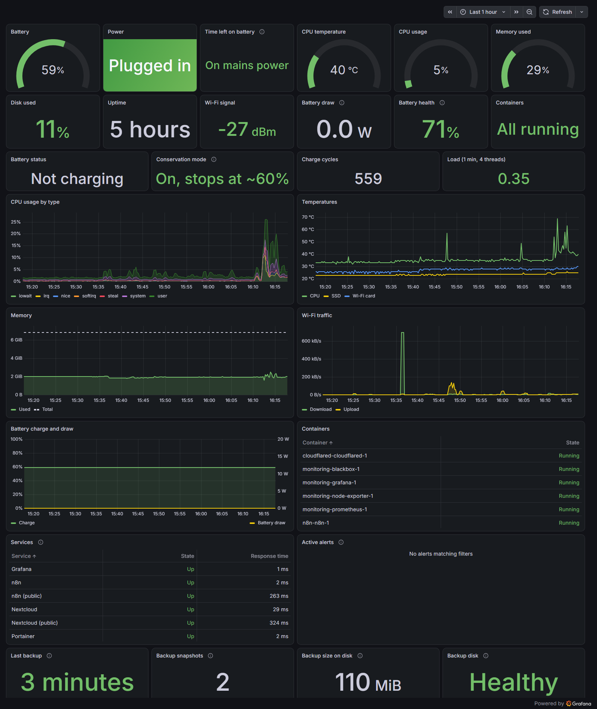
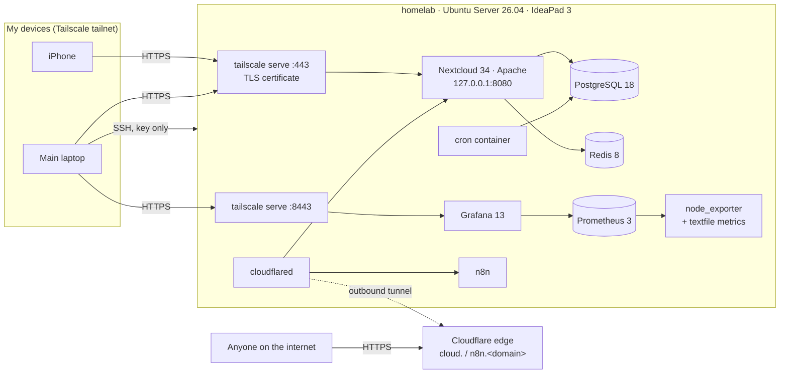

# Homelab

A personal cloud on a 2020 laptop: Ubuntu Server, Docker Compose, Nextcloud, n8n and a
password manager, with monitoring, Telegram alerts and nightly backups. Admin tools are
private on Tailscale; the cloud and the automation webhooks are public on my own domain
through a Cloudflare Tunnel. No port is open on the router.

Everything needed to rebuild the server is in this repo, except the secrets.

## What runs

| Service | What it does | How it is reached |
|---|---|---|
| **Nextcloud 34** | Files, photo backup, calendar, contacts | `https://cloud.<domain>` (public) and the tailnet |
| PostgreSQL 18 | Nextcloud's database | Internal Docker network |
| Redis 8 | File locking and shared cache | Internal Docker network |
| Nextcloud cron | Background jobs every 5 minutes | n/a |
| **n8n 2** | Workflow automation, running 24/7 | `https://n8n.<domain>` (public, for webhooks) and the tailnet |
| **Plausible CE 3** | Cookie-free website statistics, with shareable client dashboards | `https://stats.<domain>` (public) |
| **Vaultwarden** | Password manager for the Bitwarden apps | `:7443`, tailnet only |
| Portainer | Containers in the browser: logs, restarts | `:9443`, tailnet only |
| **Grafana 13** | Live dashboard and alerting to Telegram | `:8443`, tailnet only |
| Prometheus 3 | Stores metrics for 30 days | 127.0.0.1 only |
| node_exporter | Hardware and OS metrics, plus [custom ones](host/usr/local/bin/homelab-metrics.sh) | 127.0.0.1 only |
| blackbox_exporter | Checks every service's health endpoint every 30 s | 127.0.0.1 only |
| restic | Nightly encrypted backups to a USB disk | systemd timer |
| cloudflared | Cloudflare Tunnel: outbound-only connection that carries the public traffic | Outbound only |
| Tailscale | Private network, HTTPS certificate, SSH access | WireGuard |



## Architecture



## Design decisions

- **Docker Compose, not Proxmox.** With 8 GB of RAM and 2 cores, virtual machines would
  eat the headroom. Containers give the same isolation and reproducibility for almost no
  overhead.
- **Two doors, no open ports.** Every app listens on `127.0.0.1` only. Tailscale is the
  private door for everything; a Cloudflare Tunnel is the public door for exactly three
  apps (Nextcloud, n8n webhooks, and Plausible, whose tracking script every website must
  reach). Both connect outward, so the router stays closed
  and the home IP is never published. Grafana, Portainer and Vaultwarden are never
  public: Portainer holds the Docker socket, and a password vault has no reason to face
  the internet.
- **One app, two hostnames.** Nextcloud answers on the tailnet name and the public
  domain, so `overwritehost` is not set and both proxies are trusted, which keeps the
  visitor's real IP for brute-force protection. Gotcha: Nextcloud had already copied the
  old `overwritehost` from the image's env into `config.php`; removing the env var was not
  enough (`occ config:system:delete overwritehost`).
- **Storage split.** App code, config and the database stay on the internal SSD. User
  files live in one bind-mounted folder, so they can move to a bigger disk (the laptop
  has a free 2.5" bay) with a copy and a remount, not a reinstall.
- **Pinned major versions.** `nextcloud:34`, `postgres:18`, `redis:8`. Upgrades happen
  when I choose them.
- **Recommended settings, then checked.** Cron-mode background jobs, Redis locking, APCu
  local cache, phone region, maintenance window, HSTS. Nextcloud's own `occ setupchecks`
  reports no errors or warnings.

## Monitoring

The server is a laptop on Wi-Fi, so the dashboard leads with what can take it down:
mains power, battery charge and **estimated time left on battery**, then temperatures, CPU,
memory, disk, Wi-Fi signal and container state.

- node_exporter reads hardware sensors (battery, `coretemp`, NVMe, Wi-Fi card). A small
  script on a 15-second systemd timer adds what it cannot see: Wi-Fi signal from
  `/proc/net/wireless`, Lenovo conservation mode, and one series per container.
- The dashboard is [JSON in git](services/monitoring/grafana/dashboards/homelab.json),
  provisioned read-only, so the repo stays the source of truth.
- [`scripts/check-dashboard.py`](scripts/check-dashboard.py) runs every panel's query
  against Prometheus and fails on any that return nothing. It first checks itself
  against a metric that does not exist, so it cannot pass by accident.
- Tested the failure path: stopping one container turns the Containers tile red.

**Alerts** ([rules in git](services/monitoring/grafana/provisioning/alerting/rules.yaml)) go to
Telegram: server on battery, battery below 25%, CPU above 85 °C, disk above 85%, memory
above 90%, any container stopped, any service not answering, metrics missing.

Alerts come from the server itself, so a dead laptop could never report its own death.
An **outside heartbeat** closes that gap: a systemd timer pings
[healthchecks.io](https://healthchecks.io) every minute
([`homelab-heartbeat.sh`](host/usr/local/bin/homelab-heartbeat.sh)), and if the pings stop
for 5 minutes (power cut, Wi-Fi down, crash) healthchecks.io alerts on Telegram from
outside. Tested by pausing only the heartbeat while the server kept running.

[`scripts/health-check.sh`](scripts/health-check.sh) checks the whole stack in one go: host,
containers, service probes, tunnel, backups, heartbeat and firing alerts. Re-run after every
reboot test.

## Backups

[`homelab-backup.sh`](host/usr/local/bin/homelab-backup.sh) runs nightly at 03:30 (or at the
next boot if the laptop was off) and keeps 7 daily, 4 weekly and 6 monthly snapshots with
restic, encrypted, on a USB disk.

- Consistent snapshots: Nextcloud goes into maintenance mode and its PostgreSQL database
  is dumped; the SQLite apps (Vaultwarden, n8n) stop for the minute it takes.
- If the disk is unplugged, the job fails instead of quietly filling the internal SSD.
- Results are exported as metrics, so a backup that stops running raises an alert. The
  disk's SMART health is read hourly; an unplugged or failing backup disk also alerts.
- The disk is an old 160 GB laptop drive in a USB case: SMART passed, 0 bad sectors,
  10,700 power-on hours. Fine for a first copy; an off-site copy is on the roadmap.

### Restore drill

A backup nobody has restored is a hope, not a backup.
[`scripts/restore-test.sh`](scripts/restore-test.sh) restores the latest snapshot into a
scratch folder, loads the Nextcloud dump into a throwaway PostgreSQL and compares it with
the live system: row counts, user files, config, the SQLite apps, and the keys needed to
rebuild (tunnel credentials, n8n encryption key). **Result: PASS in 8 seconds.**

The first runs failed, and that was the point:

1. **Nextcloud's database login was not in the backup.** Its installer creates its own
   PostgreSQL role (`oc_admin`), and `pg_dump` leaves roles out, so a rebuilt server would
   reject Nextcloud. Fix: the job also runs `pg_dumpall --roles-only`.
2. **`pg_restore --no-owner` breaks it again,** because every table would belong to the
   wrong role. Restore roles first, then the dump with its owners. The drill now checks
   that Nextcloud's own login can read its tables.

## Security

- No ports open on the router. Public traffic arrives only through the Cloudflare Tunnel,
  and only for Nextcloud, n8n and Plausible, each behind its own login with two-factor
  sign-in available. Sign-ups are closed on all three, opened only while the owner
  account was created.
- SSH accepts keys only; root login is off.
- HTTPS with a valid certificate and HSTS. HTTPS ends at Tailscale, which cannot add
  headers, so Apache in the container sends HSTS ([`apache-hsts.conf`](services/nextcloud/apache-hsts.conf)).
- Secrets live in a mode-600 `.env` on the server and never in git.
- Ubuntu security updates install automatically.

## Problems solved

The base install needed real debugging: the laptop boots in airplane mode, and the Ubuntu
26.04.1 installer writes a Wi-Fi config its own network backend rejects. Diagnosis and
permanent fixes: **[docs/01-base-install.md](docs/01-base-install.md)**.

## Repo layout

```
host/etc/                  config files installed on the server
  ssh/sshd_config.d/       key-only SSH
  systemd/logind.conf.d/   ignore the lid
  udev/rules.d/            unblock Wi-Fi at boot
  netplan/                 Wi-Fi by interface name (example, no password)
  cloud/cloud.cfg.d/       stop cloud-init rewriting the network config
  systemd/system/          timer for the custom metrics
host/usr/local/bin/        homelab-metrics.sh
services/nextcloud/        compose.yaml, .env.example, apache-hsts.conf
services/monitoring/       compose.yaml, prometheus.yml, Grafana provisioning + dashboard
scripts/                   health-check.sh, check-dashboard.py, restore-test.sh
docs/                      write-ups and screenshots
```

## Rebuild from scratch

1. Install Ubuntu Server 26.04 LTS with OpenSSH. Wi-Fi notes: [docs/01](docs/01-base-install.md).
2. Copy `host/etc/*` into `/etc` (fill in the Wi-Fi example, mode 600), then
   `netplan apply`, `udevadm control --reload` and `systemctl restart ssh`.
3. Install Docker (`get.docker.com`) and Tailscale, then `tailscale up`.
4. Nextcloud:
   ```bash
   cp -r services/nextcloud /srv/homelab/services/ && cd /srv/homelab/services/nextcloud
   cp .env.example .env && chmod 600 .env        # fill in real values
   sudo install -d -o 33 -g 33 -m 770 /srv/data/nextcloud
   docker compose up -d
   sudo tailscale serve --bg --https=443 http://127.0.0.1:8080
   ```
5. Check: `docker compose exec -u www-data app php occ setupchecks`.
6. Other services: same pattern per folder in `services/` (copy, fill `.env`, `docker compose up -d`,
   then `tailscale serve` for the private ones). Cloudflare Tunnel one-time setup is in the
   comments of [`services/cloudflared/compose.yaml`](services/cloudflared/compose.yaml).

## Roadmap

- [x] **Backups:** restic to a USB disk every night, restore drill passing (8 s)
- [x] Monitoring dashboard: Grafana, Prometheus, node_exporter
- [x] Alerts to Telegram (tested end to end by stopping a container)
- [x] Public cloud on my domain through Cloudflare Tunnel
- [x] Vaultwarden, Portainer, n8n
- [x] Outside heartbeat (healthchecks.io) for when the whole server is down
- [ ] Off-site backup copy to Cloudflare R2: built into the backup job and the dashboard,
      switched on once `/etc/homelab/offsite.env` exists
- [ ] Move user files to a drive in the 2.5" bay
- [ ] n8n for automations, running 24/7
- [ ] Host setup as one script (later Ansible)
